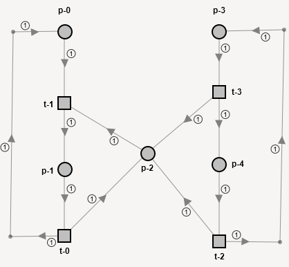

# Petri Pipe Editor
A Petri net, also known as a place/transition net (PT net), is one of several mathematical modeling languages for the description of distributed systems. It is a class of discrete event dynamic system. A Petri net is a directed bipartite graph that has two types of elements: places and transitions. Place elements are depicted as white circles and transition elements are depicted as rectangles. A place can contain any number of tokens, depicted as black circles. A transition is enabled if all places connected to it as inputs contain at least one token. Like industry standards such as UML activity diagrams, Business Process Model and Notation, and event-driven process chains, Petri nets offer a graphical notation for stepwise processes that include choice, iteration, and concurrent execution. Unlike these standards, Petri nets have an exact mathematical definition of their execution semantics, with a well-developed mathematical theory for process analysis.


## Artifacts

### Core Components

* **Places** (Circles): Represent conditions, states, or storage for resources and data.
* **Transitions** (Rectangles or Bars): Represent events, actions, or processes that change the system state.
* **Directed Arcs** (Arrows): Connect places to transitions or transitions to places (never place-to-place or transition-to-transition).
* **Tokens** (Black Dots): Reside inside places and indicate the current state or "marking" of the network.


### How It Works (Execution Semantics)

* **Enabled Transition**: A transition is enabled when all of its input places contain at least the required number of tokens.
* **Firing**: When an enabled transition fires, it consumes tokens from its input places and produces new tokens in its output places.
* **Concurrency & Choice**: Petri nets naturally model parallel execution, synchronization, resource conflicts, and non-deterministic choices.


### Why Petri Nets are Used Here

This model showcases the exact strengths of a Petri net:
* **Safety (Mutual Exclusion)**: The network structure guarantees that NS_Green and EW_Green can never hold tokens at the same time, preventing accidents.
* **Synchronization**: Transitions like T_NS_To_Red ensure one side safely waits for the other to clear before changing.


**Note:**

This implements only support simple Petri-Nets with addition that places may contain 0 - n tokens and transitions require 1 - n tokens to fire.

## To Build

```
make
```
or - for production
```
make DEPLOY=TRUE
```